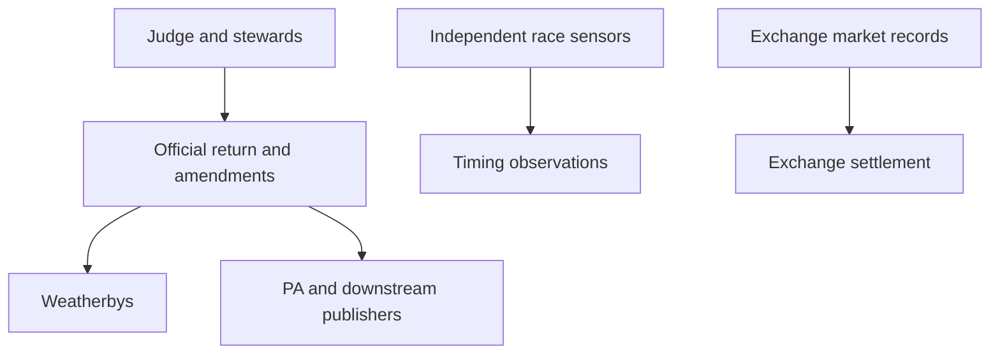

# Cloud and source qualification

## Operating environments

| Environment | Evidence and operating limit | Recovery, security and retention |
| --- | --- | --- |
| GitHub-hosted Ubuntu | The push-triggered acceptance run executed the wall-clock fixture scheduler and the transactional, archival and evaluation suites. The earlier synthetic HTTPS transport probe reached both authorities. An Actions cron event requires the default branch, can be delayed, and can be dropped. A scheduled GitHub event was outside this isolated branch's scope. | Disposable workspaces, read-only job token, checkout credentials disabled and synthetic inputs only. Existing disposable backups and replay were tested. Hosted artifacts have retention limits. These runs do not establish latency percentiles, persistent storage, clock traceability, ongoing cost or production recovery. [Actions scheduler documentation](https://docs.github.com/en/actions/reference/workflows-and-actions/events-that-trigger-workflows#schedule) |
| GitHub-hosted Windows | Both timestamp endpoints responded in the earlier one-off network run. The new hierarchy/cloud suite was run on Ubuntu. | Windows runner network evidence is specific to that VM. No persistent authorised Windows host was tested. |
| Managed Linux and any separately authorised cloud | Origin DNS/TLS route limits were recorded earlier. No new authority requests were necessary. There is no identified separately authorised permanent cloud runtime for this project. | No bypass, permanent service, secrets transfer, pricing commitment or deployment occurred. Any new production route requires network approval, monotonic recovery, durable custody, clock evidence and an approved budget. |
| GitLab CI | The project repository exposes a GitHub remote. Genesis has a read-only GitLab inventory module, but no Value Watch GitLab project, credentials, runners or schedule were verified. GitLab schedules use a queue and an owner permission context, so they give no deadline assurance. | A matching project, scope, provider permission and storage/retention controls would be required before actual acceptance. [Scheduled pipelines](https://docs.gitlab.com/ci/pipelines/schedules/) · [Scheduling limits](https://docs.gitlab.com/administration/cicd/limits/) · [Artifact retention](https://docs.gitlab.com/ci/jobs/job_artifacts/) |
| Owner's Windows or Genesis-managed machine | No device session was available for this task. A running host could poll the fixture scheduler, but host availability, clock status and long-lived custody were not measured. | Secure startup, backups, path/identity controls, clock warnings and separation from other projects require host acceptance. Genesis requires an explicit project/branch allowlist and bounded recipes. |

The hosted test simulated one elapsed slot and polled a future slot on the runner's real wall clock. Duplicate polling left one completed slot and one frozen fixture. Existing forced exits, concurrent writers, missed windows, delayed/invalid receipts, clock rollback, exact input hashes, authorised fixture outcomes and backup/evaluation replay were run as regression receipts on the same hosted job. This gives a reproducible cloud fixture result. Real platform cancellation timing, reschedule frequency, clock reference offset, external provider availability over time and restricted persistent storage still need independent operating evidence.

Four recent runs of the existing Operations Director workflow were reported successful with event `schedule` on `main` (45740813627, 45670153622, 45537113949, 45464240821). Their published run creation times establish execution but do not independently establish nominal trigger time or missed-run frequency. These were pre-existing operations runs and are distinct from the fixture acceptance. [Scheduled operations history](https://github.com/aurelian2483-cmd/value-watch-lab/actions/workflows/operations-scheduled-monitor.yml)

### Genesis boundary

Read-only connector inspection of the Genesis branch `codex/team4-overnight-discovery` identified `team4/overnight.py`, the configuration example, validation helpers and the GitLab inventory client. Its example has empty project maps. The controller reads pinned project and branch state, validates recipes, filters credential-bearing environment variables for local commands and records events. GitLab inventory is bounded and targets the GitLab API. This inspection confirms a candidate for read-only reporting and independently approved bounded checks. It establishes neither deployed automation nor access to the user's PC. Keep the repositories and worktrees isolated. Before any controller activation, use the existing approval gate and an explicit allowlist for archive checksum verification or synthetic regression only. A blocked prerequisite should produce one durable event and select a different already-approved task. Keep scheduled actions, publication, archive writes and model changes outside the allowlist. No Genesis configuration or repository change was made.

## Additional racing sources

| Candidate | Documented evidence and rights | Disposition |
| --- | --- | --- |
| Sharman and Wilson, *Racehorses are getting faster*, Dryad DOI 10.5061/dryad.qn82p | University of Exeter deposit lists elite turf winners and an historical 1997–2012 GB turf-flat speed workbook sourced from Raceform Interactive and older form publications. Dryad's publication policy uses CC0 and requires depositors to warrant rights. The deposit description is narrower than original returns, complete declarations and versioned corrections. | Potentially useful for historical speed or data-quality exercises within the deposit grant. The data lineage is identified as attributed historical products, so it cannot independently corroborate the same Raceform/official return. No file was downloaded and no project intake was performed. [Dryad record](https://datadryad.org/dataset/doi:10.5061/dryad.qn82p) · [Publication policy](https://datadryad.org/publication_policy) |
| Royal Veterinary College / TurfTrax tracking study | The study describes 3,357 races from 10 GB courses, 2005–2007, with speed and position observations independently made by a racecourse tracking system. The academic article is available. Rights to obtain and retain the full tracking dataset and amended official results were not verified. | Contact only with approval. Potentially distinct timing evidence where linked clocks and event IDs can be authenticated. Selected-course historical tracking cannot establish complete and amended adjudication. [Paper and methods](https://pmc.ncbi.nlm.nih.gov/articles/PMC3391435/) · [RVC repository](https://rvc-repository.worktribe.com/output/1431127/accuracy-of-the-turftrax-racing-data-system-for-determination-of-equine-speed-and-position) |
| OUP British horseracing deterrence study | Authors describe Racing Post-derived data on approximately 60,000 races from 2012–2021 and disclose outcome and runner fields. Free access to a licensed complete immutable source dataset was not verified. | Evidence of an academic access route to discuss with the rights holder under approval. A research paper's access status does not license source bytes or establish independent result provenance. [Article](https://academic.oup.com/oep/article/78/4/1087/8771929) |
| Public scraped or cross-sport archives | An open horse-data repository describes scraped and re-used source material. Repository terms do not establish rights to underlying result collections. The TrapStats CC BY sample covers greyhounds and describes its own upstream verification. | Neither demonstrated the required British thoroughbred population, adjudication and reuse rights. The greyhound sample has a different sport population. [Horse-data repository](https://github.com/Sheep-Meadow-Road-Games/open-horse-data) · [Greyhound dataset scope](https://trapstats.co.uk/en/data) |

### Result lineage

BHA identifies distribution of the official result to Weatherbys and PA. A media copy can provide a separate delivery check. Independent race sensors provide separately observed times or positions. Exchange settlement is a separate economic event and may depend on the official outcome. The graph records distinct evidence types. It does not assert independence of the events or of licensed copies. Retain one event owner's source ID, release and correction versions, original timestamps, a dated coverage denominator and specific reasons for every rejected row. [BHA official distribution](https://www.britishhorseracing.com/faqs/how-is-the-official-full-race-result-distributed/) · [Historical Betfair specification and rights](https://historicdata.betfair.com/Betfair-Historical-Data-Feed-Specification.pdf)

### Addendum for the unsent enquiries

For BHA/Weatherbys, ask for a sample evidence manifest listing original adjudicator, source licence, distribution source, release time, amendment sequence and whether a reviewer may independently reacquire the identical version. Ask Open TSA for a root fingerprint published via an independent audited channel, its public policy and UTC traceability evidence, a signed status response for the actual signer and both intermediates, status issuance timing and approval for retaining/sharing receipts and status records. The existing draft messages, recipient roles and no-charge pilot scope are in the [permission pack](../external-dependencies/permission-requests.md). No enquiry was sent.

### Further timestamp profile references

The German Federal Chamber of Notaries publishes an institutional RFC 3161 practice statement describing SHA-256/384/512 and an official German time source. Its profile, access eligibility, signed accuracy, complete status material, any licence/fees and archival rights remain unverified here. A separate EVC Global Trusted Sign statement describes subscriber-issued timestamps under an eIDAS profile. No trial, latency, nonce, price or research rights were established. These are documentary candidates alongside GlobalSign, SwissSign and Stamper in the [prior comparison](../external-dependencies/README.md). No provider was contacted. Use no external witness for cutoff without a separately qualified dated bound. [Notaries practice statement](https://zertifizierungsstelle.bnotk.de/fileadmin/user_upload_zs/Dokumente/FINAL_-_TSA_Policy_und_Practice_Statement_des_VDA_BNotK__Version_2.9_-_0325__engl.pdf) · [EVC GTS policy](https://pki.globaltrustedsign.com/storage/docs/en/DP03_GTS.pdf)
